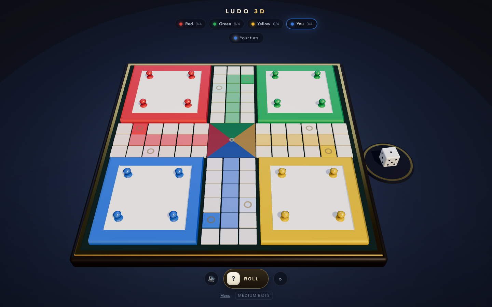
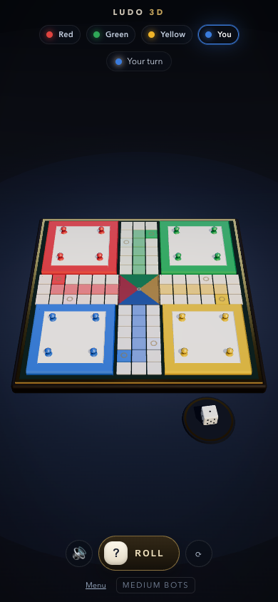
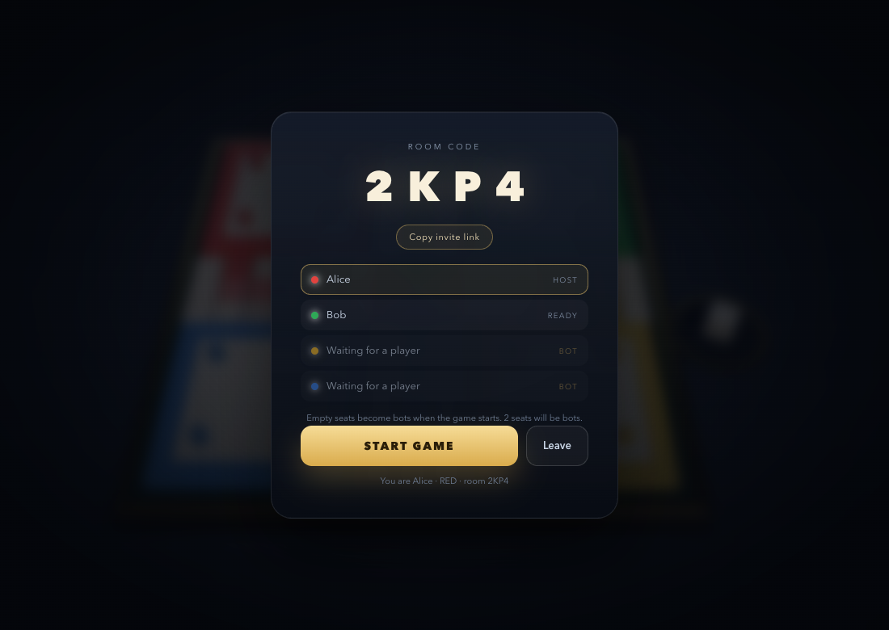

# Ludo 3D

**Live:** https://ludo3d.zeekaboo.workers.dev

A genuine 3D Ludo board game that runs in the browser — wooden board, brass inlay,
glossy pawns, a dice tray on the table and three bots to beat. Play solo, pass one
device around, or create an online room and share a 4-letter code; empty seats are
filled by bots. Deployed on Cloudflare Workers + Durable Objects.



<p align="center">
  
  
</p>

## What is in the box

- **3D board** modelled from code (no downloaded assets): 52-cell ring, four
  6×6 bases, five-cell home columns, brass trim, felt field and a real dice tray.
- **Full Ludo rules**: six to leave base, exact roll to finish, captures, safe
  squares, extra turns for a six / capture / home, three-six forfeit, ranking.
- **Three bot personalities** (easy / medium / hard) with a threat-aware
  heuristic instead of random moves.
- **Pass & play** for four humans on one device, or solo against three bots.
- **Online rooms**: create a room, share the 4-letter code (or invite link), and
  friends join from any device. The server is authoritative, seats can be
  reclaimed after a refresh, and anyone who drops off is taken over by a bot.
- **Live scoreboard**: every player chip shows how much of the race is done
  (percentage of the 57 steps per token) plus a capture light — red until that
  player sends someone back to base, green after the first capture.
- **Animation**: hop-by-hop pawn movement, capture arcs, dice tumble that always
  lands on the value the rules already decided, camera-fitting for any screen.
- **Mobile ready**: touch controls, responsive HUD, portrait framing, PWA
  manifest so it can be installed to the home screen.
- **Synthesised sound effects** (no audio files) with a mute toggle.

## Stack

| Part | Choice |
| --- | --- |
| Rendering | Three.js + React Three Fiber + drei |
| UI | React 19 + plain CSS |
| State | Zustand |
| Rules | `@ludo/core` — pure TypeScript, zero Three.js |
| Online | Cloudflare Workers + one Durable Object per room, native WebSockets |
| Tests | Vitest (44 tests, 200 seeded full games) |
| Build | Vite + Wrangler (Workers static assets) |

## Getting started

```bash
pnpm install
pnpm dev          # client  → http://localhost:5173
pnpm dev:server   # rooms   → http://localhost:3001  (wrangler dev, needed for online)
pnpm test         # rules + bot test suite
pnpm build        # typecheck + production build
```

Solo and pass & play work without the room server. For online rooms run both
commands — the browser connects to `ws://localhost:3001/ws`.

### Deploy to Cloudflare

```bash
npx wrangler login   # once, opens the browser
pnpm run deploy     # builds the client, uploads assets + worker + DO
```

The Worker serves the built client from `apps/web/dist` (SPA fallback) and routes
`/ws?code=XXXX` to the Durable Object for that room, so everything lives on one
origin. `pnpm run deploy` prints the `*.workers.dev` URL.

## Project layout

```
packages/core/            pure game logic, no rendering
  src/board.ts            52-cell ring, home columns, safe cells, base spots
  src/rules.ts            legal moves, captures, extra turns, ranking
  src/bot.ts              easy / medium / hard move selection
  src/rng.ts              seedable mulberry32
  src/protocol.ts         shared wire types + animation timings
  src/__tests__/          44 tests including 200 simulated games

apps/web/
  src/store.ts            turn loop: roll → move → animate → next player
  src/net.ts              native WebSocket client (dev: :3001, prod: same origin)
  src/scene/Board.tsx     board geometry, instanced tiles, base plates, home
  src/scene/Tokens.tsx    pawn mesh, path animation, picking
  src/scene/Dice.tsx      result-driven dice animation, tray
  src/scene/CameraRig.tsx perspective-correct camera fitting + orbit controls
  src/ui/                 HUD, start menu, lobby, standings, toasts

apps/edge/                Cloudflare Worker deployment
  src/index.ts            routes /ws to the room DO, serves static assets
  src/room-object.ts      Durable Object: sockets, hello/join/rejoin, commands
  src/room.ts             authoritative room: turns, bots, persistence
  wrangler.toml           assets + ROOMS binding + SQLite DO migration
```

## Online rooms

1. **Create** a room — the host gets a 4-letter code and an invite link
   (`/?room=CODE`).
2. **Join** from up to three other devices with the code, or open the link.
3. The host presses **Start**. Any seat that is still open becomes a bot, so a
   room with two people is a 2v2 humans-vs-bots match.

How the server drives it:

- Each room is a single **Durable Object** addressed by its code, so all players
  of a room hit the same single-threaded instance — no locks, no races.
- Clients only send intents: `roll` and `move {token}` over a raw WebSocket.
- The room validates everything with `@ludo/core` — same rules as the browser.
- The server rolls, resolves legal moves, runs bot turns, and paces the result so
  each client can play the same animation (`TIMING` is shared in `protocol.ts`).
- A player token is stored in `localStorage`, so a refresh rejoins the same seat.
- If a player disconnects mid-game the seat is handed to a bot immediately; they
  can still come back and take over again by reopening the invite link.
- Room state is mirrored into Durable Object storage, so a cold start keeps the
  table and the bots carry on.

## Board model

The board is a 15×15 grid. `[col, row]` maps to world `x = col - 7`, `z = row - 7`.

A token position is a single number:

| value | meaning |
| --- | --- |
| `-1` | in base |
| `0…50` | steps along the 52-cell ring (0 = own start cell) |
| `51…55` | home column |
| `56` | home (center) |

Ring cell for a position: `MAIN_PATH[(startIndex[color] + pos) % 52]`.
Safe cells: the four start cells plus the star cells eight steps later
(`start + 8`). Each colour owns a 13-cell arm, which keeps the layout symmetric.

## Design decisions worth keeping

1. **Logic never imports Three.js.** The whole game is replayed, tested and run
   authoritatively inside the Cloudflare Durable Object with the same package.
2. **The dice result comes first, the animation follows.** The RNG decides the
   value, then the die is animated onto that face. This removes a whole class of
   “the dice showed six but I moved three” bugs and makes online play cheat-proof.
3. **Clients send intents, not state.** Room state only moves forward when the
   server applies a validated move, so a modified client cannot cheat.
4. **View state is derived from one `GameState`.** Animations are descriptors
   (`anims[key] = { from, cells, start, duration }`) so React re-renders never
   fight the frame loop.
5. **Instanced tiles.** 72 track tiles are one draw call, keeping mobile at 60fps.

## Performance & battery

A 3D board game is only nice if it does not eat the phone alive.

- **Demand rendering.** The canvas runs with `frameloop="demand"` plus a small
  scheduler that asks for a frame only while the dice tumbles, a pawn hops or
  the game state changes. Idle board = **zero rendered frames** (measured 0
  frames over 2s), so the GPU is genuinely asleep between turns.
- **Capped pixel ratio** (1.5 desktop, 1.25 on touch devices), 512–1024 shadow
  maps, antialiasing off on phones and a 64px environment map there.
- **Draw calls.** 72 track tiles, 16 parking rings and 8 safe markers are
  instanced; the table is one disc plus one additive glow plane.
- **Cheaper chrome.** CSS blurs were reduced (backdrop-filter is expensive on
  mobile GPUs) and the mute toggle now just ramps a master gain node instead of
  muting every oscillator.
- **Server.** Durable Object state is written only on stable turns instead of
  every animation phase, empty rooms are deleted immediately, and abandoned
  rooms are garbage collected by a 24h alarm.

## Rules implemented

- Roll a six to bring a token out of the base.
- Six, capture or reaching home grants another roll.
- Three consecutive sixes forfeit the turn.
- An exact roll is required to land on home; overshooting is illegal.
- Capturing is impossible on the eight safe cells; own tokens may stack.
- Landing on an opponent sends every opponent token on that cell back to base.
- Finishing all four tokens records your place; finished players are skipped.
- The game ends when three players have finished; the fourth gets last place.

## Roadmap

- [x] Playable Ludo 3D vs three bots
- [x] Mobile / PWA shell
- [x] Online 4-player rooms with codes, bots for empty seats and reconnects
- [ ] Snakes & Ladders (reuses board, dice, seats and turn loop)
- [ ] Chess 3D (`chess.js` for rules)
- [ ] Carrom 3D (Rapier physics — the big visual showpiece)
- [ ] Optional variants: blocking, team play, timer per turn
